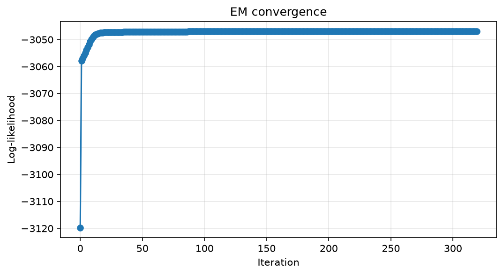
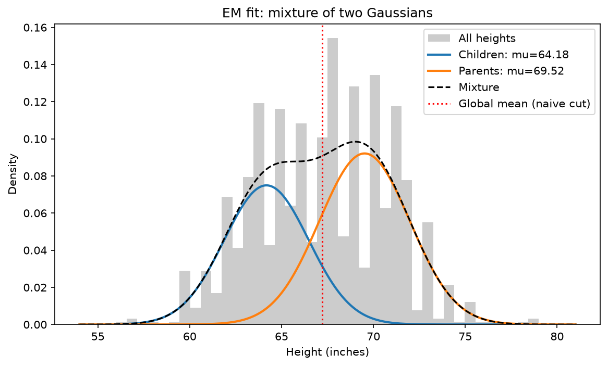

# formative3-group19
## Part 1: EM Algorithm (Merveille Ineza)

**Folder:** `part1-em-algorithm/`
**How to run:** open `part1_em.ipynb` and click **Run All**.

### What we did
We mixed fathers' and adult children's heights from Galton's dataset (in inches) into one list with no labels, and used the EM algorithm, written from scratch, to find two Gaussian groups.

- **Initialization:** means at the 25th and 75th percentiles, equal variances, equal weights (0.5 each).
- **E-step:** for each height, compute the probability it belongs to each group.
- **M-step:** use those probabilities to update each group's mean, variance and weight.
- **Stop:** when the log-likelihood changes by less than 0.000001.

### Tracking table

| Iteration | μ1 | μ2 | σ1² | σ2² | π1 | π2 | Log-Likelihood |
|---|---|---|---|---|---|---|---|
| 0 | 64.5000 | 70.0000 | 12.7241 | 12.7241 | 0.5000 | 0.5000 | -3119.8222 |
| 1 | 65.2205 | 69.2054 | 9.0603 | 8.4468 | 0.5011 | 0.4989 | -3057.9135 |
| 2 | 65.1609 | 69.2600 | 8.9420 | 8.1040 | 0.5005 | 0.4995 | -3056.9719 |

### Convergence
The log-likelihood goes up every iteration and flattens out after about 330 iterations.

### Final fit

| Group | μ (mean) | σ² (variance) | π (weight) |
|---|---|---|---|
| Group 1 ("Children") | 64.177 | 5.302 | 0.432 |
| Group 2 ("Parents") | 69.519 | 6.041 | 0.568 |

### Should we split at the global mean? No.
The global mean is 67.21 inches. The groups overlap, so a hard cut puts tall children with the parents and short fathers with the children, which pushes both pile means away from the true means. EM gives each height a probability instead.

| | True labels | Global-mean split | EM |
|---|---|---|---|
| Mean of Children | 66.746 | 64.260 | 64.177 |
| Mean of Parents | 69.316 | 70.215 | 69.519 |
| Accuracy | 1.000 | 0.608 | 0.565 |

### What we found
EM split the data mostly by gender, not parents vs children, because Galton's "children" are adults (sons and daughters). Fathers and adult children are only 2.6 inches apart on average, so height alone can't separate them well. Both methods score below the 82% you'd get by calling everyone a child (934 of 1,139 heights).
