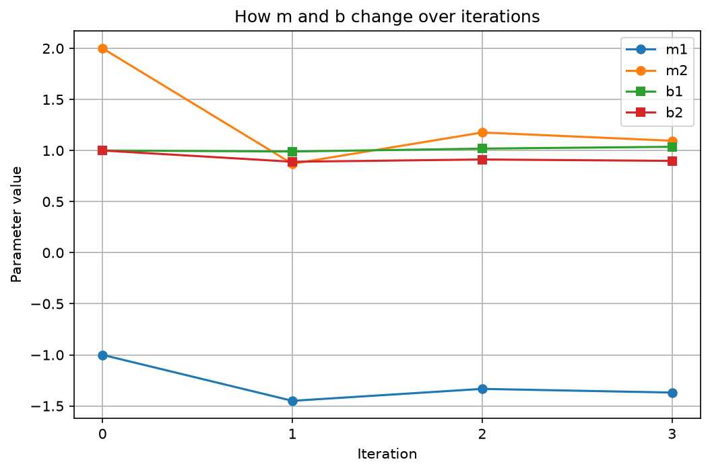
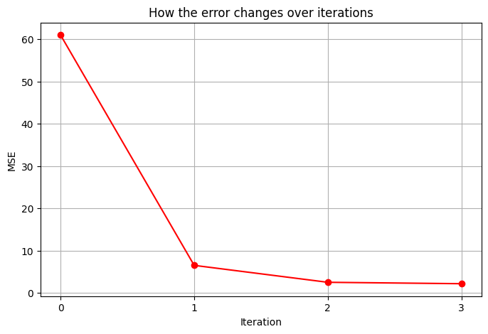

# Formative 3 — Group 19

**Probability Distributions, Bayesian Probability and Gradient Descent**

**Members:** Habibllah Ayoola Ayodele, Keira Mutoni and Merveille Shekina Ineza

## Part 1: Expectation-Maximization

We implemented EM from scratch to fit two Gaussian components to **1,139 unlabeled heights**: 934 adult children and 205 fathers.

- **Initialization:** percentile-based means, overall variance and equal mixing weights.
- **E-step:** calculate component membership probabilities.
- **M-step:** update means, variances and mixing weights.
- **Stopping rule:** log-likelihood change below 0.000001.

### Optimization tracking

| Iteration | μ₁ | μ₂ | σ₁² | σ₂² | π₁ | π₂ | Log-likelihood |
|---|---|---|---|---|---|---|---|
| 0 | 64.5000 | 70.0000 | 12.7241 | 12.7241 | 0.5000 | 0.5000 | -3119.8222 |
| 1 | 65.2205 | 69.2054 | 9.0603 | 8.4468 | 0.5011 | 0.4989 | -3057.9135 |
| 2 | 65.1609 | 69.2600 | 8.9420 | 8.1040 | 0.5005 | 0.4995 | -3056.9719 |

### Results

The model converged after **319 updates**.

The fitted component means were **64.177** and **69.519 inches**. The graph’s Children/Parents labels represent an attempted interpretation, not established demographic groups.

### Should we split at the global mean?

**No—a hard split ignores overlapping populations and forces uncertain observations into one group.**

The global mean was **67.21 inches**, producing pile means of **64.260** and **70.215 inches**.

For parent/child classification:

- Global-mean split: **60.8% accuracy**
- EM component assignment: **56.5% accuracy**
- Always predict “child”: **82.0% accuracy**

**Finding:** EM improved the mixture fit but did not reliably separate fathers from adult children.

### Live demonstration

Enter a height in the notebook to display both component probabilities.

At **65 inches**, the model returns approximately **80.53% for component 1** and **19.47% for component 2**.

[Open Part 1 notebook](part1-em-algorithm/part1_em.ipynb)

## Part 2: Bayesian Probability

We used **50,000 IMDb reviews** to calculate the probability that a review is positive given a keyword.

**Positive indicators:** excellent, wonderful, amazing  
**Negative indicators:** terrible, waste, boring

Each keyword counts once per review.

### Results

| Keyword | Prior | Likelihood | Marginal | Positive posterior |
|---|---|---|---|---|
| excellent | 0.5000 | 0.1145 | 0.0709 | 0.8074 |
| wonderful | 0.5000 | 0.0902 | 0.0555 | 0.8120 |
| amazing | 0.5000 | 0.0671 | 0.0431 | 0.7783 |
| terrible | 0.5000 | 0.0152 | 0.0539 | 0.1414 |
| waste | 0.5000 | 0.0070 | 0.0506 | 0.0687 |
| boring | 0.5000 | 0.0236 | 0.0610 | 0.1936 |

**Finding:** positive keywords raised the positive probability above the 50% prior; negative keywords lowered it. Context, negation and sarcasm remain limitations.

### Live demonstration

Show the raw-count table and worked example for **“excellent”** in the notebook.

[Open Part 2 notebook](Formative3_Part2_Bayes_Team19.ipynb)

## Part 3: Manual Gradient Descent

We calculated three updates using matrix multiplication and a learning rate of **0.01**. Each member completes and explains one update.

We follow the assignment’s vector initialization for `b`, giving one bias per observation.

| State | m | b | MSE |
|---|---|---|---|
| Initial | [-1, 2] | [1, 1] | 61.000000 |
| Update 1 | [-1.45, 0.87] | [0.99, 0.89] | 6.503300 |
| Update 2 | [-1.3331, 1.1765] | [1.0185, 0.9121] | 2.497400 |
| Update 3 | [-1.369037, 1.095583] | [1.036351, 0.898653] | 2.164498 |

The handwritten PDF contains the chain-rule derivations and complete calculations.

**Finding:** parameters can change direction while the overall error decreases.

## Part 4: Gradient Descent in Python

Our modular implementation calculates predictions, MSE, gradients and parameter updates.

The notebook includes:

- A detailed iteration table matching the manual calculations.
- A SciPy derivative example and numerical checks of the slope gradients.
- Final predictions of **[2.954063, 6.378335]**.
- Final MSE of **2.164498**.

### Parameter changes

### Error reduction

**Finding:** All three updates reduced MSE, although three updates do not establish convergence.

## Team Contributions

All members contributed to every part. The contributions PDF and Git history document individual work.

- **Habibllah:** manual calculations, interactive EM test, Bayesian count display, and gradient-descent iteration table.
- **Keira:** original Bayesian and gradient-descent implementations, plus EM cross-work and a manual update.
- **Shekina:** original EM implementation, plus Bayesian and gradient-descent cross-work and a manual update.

## Running the Notebooks

- **Part 1:** upload `em_gmm.py` and `GaltonFamilies.csv`, then run the notebook.
- **Part 2:** upload the IMDb CSV and check its loading path.
- **Part 4:** run initialization before the update loop; the initial MSE should be **61**.

## Submission Materials

- Jupyter notebooks and supporting files - 
- Handwritten Part 3 calculations PDF - 
- Individual contributions PDF - 
